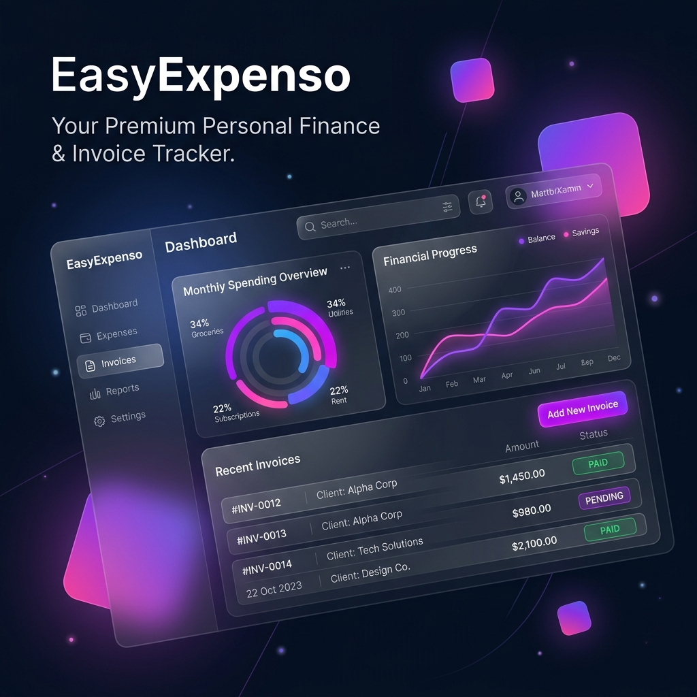

# EasyExpenso



**EasyExpenso** is a sleek, modern, and premium personal finance & invoice tracking web application. Designed with a stunning dark mode glassmorphism interface, it provides users with an intuitive and visually pleasing experience to manage their daily expenses, business invoices, and monthly budgets.

## Features
- **Dashboard Overview**: Beautiful charts and summaries for business and casual spending.
- **Invoice Tracking**: Create and track business invoices with auto-calculated totals.
- **Casual Expenses**: Log daily casual expenses and categorize them for better insights.
- **Budgeting**: Set monthly budgets and get real-time tracking against your spending limits.
- **Auto-Scan SMS**: Paste bank debit SMS messages and automatically parse the merchant and amount into an expense.
- **Export Data**: Export all transactions to JSON.

## Tech Stack
- **Frontend**: HTML5, Vanilla JavaScript, CSS3 (Glassmorphism & Dark Mode)
- **Backend**: Python, Flask, SQLite3
- **Mobile/Native**: Capacitor (Ready for iOS/Android builds)

## Getting Started

1. **Install Python Dependencies** (requires Python 3.8+):
   ```bash
   cd backend
   python -m venv venv
   venv\Scripts\python -m pip install -r requirements.txt
   ```
2. **Run Application**:
   Simply execute `start.bat` in the root folder.
   ```bash
   .\start.bat
   ```
   The app will run locally at `http://localhost:5000/`.

## License
© 2025 EasyExpenso. All rights reserved.
